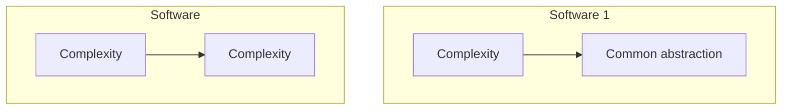
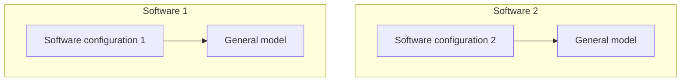
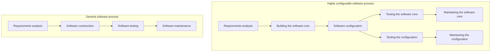

---
categories:
- coding
date: 2017-01-17
lastmod: 2017-01-17
mermaid: true
slug: development-of-highly-configurable-software
tags:
- Software Engineering
- Programming
title: Developing Highly Configurable Software
featured: true
---

Configurability is one of the important problems in software engineering practice. Configuration files, together with the executable, form the elements of runtime version control for a piece of software. Interpreted languages such as Visual Basic, Python and Lua, which usually show up in the form of so-called "scripts", further raise the configurability of large software like operating systems and games, while domain-driven design, even as it emphasizes the domain model, has also pushed forward domain-specific languages that describe configuration domain models. In industrial control, software configurability is described by the concept of configuration; in game development, it is usually described in terms of engines and scripts.

## 1 Basic principles

The root of software complexity is the complexity of the real world. When software complexity exceeds what a person can hold in their head, development becomes difficult or fails outright. A good software engineering methodology supplies a good abstract model of the real world, managing complexity through a sound hierarchy of abstraction so that a person can grasp the software level by level, from the whole down to the details. Complexity that comes from the real world does not shrink or vanish, but it does get constrained.

High configurability can, to some degree, solve the problem of fast-changing requirements: take the invariant part of the software as the model, and constrain the volatile part through configuration files and the like.

## 2 How to build it

To build highly configurable software, you should first establish a general software model for the domain, then apply configuration techniques to that model. Different configurations plus the model finally produce different software instances.

### 2.1 Modeling

Modeling is a hard problem. It depends on the scenario at design time, requires domain knowledge and design experience, and calls for close collaboration with domain experts. There are a few classic books on this: [Domain-Driven Design](https://book.douban.com/subject/26819666/) and [Implementing Domain-Driven Design](https://book.douban.com/subject/25844633/).

### 2.2 Configuration techniques

#### 2.2.1 Configuration files

Configuration files are the most widely used and most basic configuration technique. They mainly describe the data a program needs at startup and while running, and generally do not describe the program's runtime logic directly. Common formats include ini, xml and json; a quick comparison:

| Format   | Expressiveness    | Readability  | Typical use     | Example          |
| ---- | ------- | ---- | ---------- | ----------- |
| ini  | Weak, cannot nest | Best   | Program startup parameters.    | Startup directory, IP address.  |
| xml  | Strongest      | Worst   | Serializing complex objects.  | Data frame structure and parsing rules. |
| json | Middling      | Middling   | Web API interfaces. | A weather forecast service API.  |

#### 2.2.2 Scripting languages

Large programs are often built by combining several programming languages: a compiled language implements the relatively fixed parts and the parts where runtime performance is critical, while an interpreted language implements the volatile parts. Linux, for instance, implements many tools in C and then combines them through bash scripts; large games are built on a C++ engine and use Lua scripts to describe the logic of game actions.

#### 2.2.3 Domain-specific languages

A domain-specific language sits between ordinary configuration files and program code: a computer programming language with restricted expressiveness, aimed at one particular domain.

Domain-specific languages divide further into internal DSLs, external DSLs and language workbenches. An internal DSL is a special way of writing code in the host language and hardly counts as configuration; an external DSL designs a new language to do the expressing and still falls within the range of textual configuration. A language workbench mainly offers a visual way of configuring, otherwise known as visual programming.

A DSL sits between configuration files and scripts. It offers high expressiveness within its domain, is easier for domain experts to understand, and speeds up turning expert knowledge into software.

Depending on the model, all three techniques can be applied in highly configurable software development. The table below compares their main characteristics and typical uses.

| Technique   | Expressiveness                       | Readability                 | Typical use                   | Example                                |
| ------ | -------------------------- | ------------------- | ------------------------ | --------------------------------- |
| Configuration files   | Describes the data the program needs to run; generally does not describe runtime logic directly. | Depends on the specific format.  | Program startup parameters.                  | Startup directory, network address.                      |
| Scripting languages   | Describes runtime logic directly.               | Understandable only to programmers, not to domain experts. | Describing volatile logic when the basic interface is fixed.        | Python scripts describing a monitoring workflow on top of a C++ device-monitoring interface.  |
| Domain-specific languages | Describes the configuration of the domain model, and so describes runtime logic indirectly.    | Understandable to programmers and to domain experts. | A well-accepted domain model exists, and its configuration is rich and volatile. | Expressing fault handling with a "state–response" model, and writing a DSL for the actual content. |

## 3 Engineering practice

As the figure shows, highly configurable software development actually changes the traditional development process, and raises the standing of software configuration in the software life cycle. What follows describes the impact of high configurability on each phase of traditional development.

### 3.1 Requirements analysis

At the requirements phase, compared with ordinary development, highly configurable development has to analyze two extra questions:

1. Whether high configurability is necessary. This is decided mainly by the software's scope of applicability: is the software meant to be generalized, and are the requirements it must meet volatile? The more scenarios it has to fit and the more volatile the requirements, the greater the necessity. If the software serves one basically fixed scenario, there is no need to use configuration.
2. Separate model requirements from configuration requirements. When gathering requirements, gather them for all the software's application scenarios, analyze the requirement extensions that generalizing may bring, study as many cases as possible, dig down to extract the invariants of the system, abstract the system's model, and identify the volatile parts as configuration requirements.

### 3.2  Software construction

Construction in highly configurable development splits into two phases:

1. Building the software core: done by programmers. High configurability places high demands on architecture design. Under the object-oriented paradigm you need to understand and apply OO design principles deeply, make heavy use of the various structural design patterns, and use runtime association techniques such as reflection and dependency injection.
2. Configuring the software: can be done by a programmer, or by a domain expert. Since configuration has become an important part of the software, configuration files should be managed as strictly as source code and put under version control. Manual configuration is prone to error, so provide visual configuration tools wherever possible and restrict users from editing configuration at will.

### 3.3 Software testing

Corresponding to the two construction phases, testing of highly configurable software also splits into two parts:

1. Testing the software core. Test cases should cover configurations for a variety of scenarios, and those scenarios must include the boundary cases of the model, so that as many core defects as possible are eliminated by testing rather than surfacing after configuration when the software is rolled out.

2. Testing the configuration. Only after configuration testing can the software be applied in a concrete scenario. Configuration is often done by domain experts rather than programmers, so it is best to validate the configuration and to provide testing tools and a written test procedure for the configured state, so that domain experts can complete the testing too.

### 3.4  Software maintenance

Corresponding to the two construction phases, maintenance of highly configurable software also splits into two parts:

1. Maintaining the software core: general feature upgrades are done by upgrading the core. Changes to core functionality should keep configurations compatible; when the configuration format has to change, provide an upgrade and conversion facility for configurations.

2. Maintaining the configuration: when user requirements and application scenarios change in ways the core anticipated, a domain expert can make the change by editing the configuration. Configuration gradually becomes an important asset of the user.
