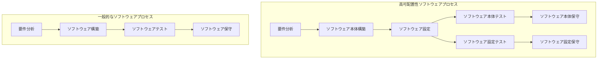

---
categories:
- coding
date: 2017-01-17
lastmod: 2017-01-17
mermaid: true
slug: development-of-highly-configurable-software
tags:
- ソフトウェア工学
- プログラミング
title: 高可配置性ソフトウェア開発
featured: true
---

可配置性はソフトウェア工学の実践における重要な問題の一つである。設定ファイルは実行ファイルとともに、ソフトウェアの実行時バージョン管理を構成する要素となる。Visual Basic、Python、Lua などのインタプリタ型言語は、いわゆる「スクリプト」の形で現れることが多く、オペレーティングシステムやゲームなどの大規模ソフトウェアの可配置性をさらに高めてきた。また、ドメイン駆動設計はドメインモデルを強調すると同時に、設定ドメインモデルを記述するドメイン固有言語の発展も促した。産業制御の分野では、ソフトウェアの可配置性は組態（コンフィギュレーション）という概念で語られる。ゲーム開発の分野では、一般にエンジンとスクリプトという概念で語られる。

## 1 基本原理

ソフトウェアの複雑さの根源は現実世界の複雑さにある。ソフトウェアの複雑さが人の理解能力を超えると、ソフトウェア開発の困難、さらには失敗をもたらす。優れたソフトウェア工学の方法論は現実世界の良好な抽象モデルを与え、合理的な抽象階層構造によってソフトウェアの複雑さを管理し、人がある全体から細部へと階層的にソフトウェアを把握できるようにする。現実世界に由来する複雑さは減少も消滅もしないが、制約を受けることになる。

高可配置性は、急速な要求変更の問題をある程度解決できる。ソフトウェアの中で不変の部分をモデルとして捉え、変わりやすい部分を設定ファイルなどの方法で制約するのである。

## 2 構築方法

高可配置性ソフトウェアを構築するには、まずドメインの特徴に応じて汎用ソフトウェアモデルを確立し、次にそのモデルに対して設定技術を用いる。異なる設定とモデルの組み合わせが、最終的に異なるソフトウェアインスタンスを構築する。

### 2.1 モデリング

モデリングの問題は非常に複雑な問題であり、設計時のシナリオによって異なる。ドメイン知識と設計経験を必要とし、ドメインの専門家と密接に協力する必要がある。この分野にはいくつかの古典がある：[『エリック・エヴァンスのドメイン駆動設計』](https://book.douban.com/subject/26819666/)と[『実践ドメイン駆動設計』](https://book.douban.com/subject/25844633/)。

### 2.2 設定技術

#### 2.2.1 設定ファイル

設定ファイルは最も広く使われ、最も基本的な設定技術である。設定ファイルは主にソフトウェアの起動および実行に必要なデータを記述するために用いられ、一般にソフトウェアの実行ロジックを直接記述するものではない。一般的な設定ファイル形式には ini、xml、json などがある。簡単な比較を下表に示す。

| 形式   | 表現力    | 可読性  | 典型的な用途     | 例          |
| ---- | ------- | ---- | ---------- | ----------- |
| ini  | 弱い、ネスト不可 | 最も良い   | ソフトウェアの起動パラメータ。    | 起動ディレクトリ、IP アドレス。  |
| xml  | 最も強い      | 最も悪い   | 複雑なオブジェクトのシリアライズ。  | データフレームの構造と解析規則。 |
| json | 普通      | 普通   | Web API インタフェース。 | 天気予報サービスのインタフェース。  |

#### 2.2.2 スクリプト言語

大規模なプログラムは、しばしば複数のプログラミング言語を組み合わせて実現される。一般に、コンパイル型言語でシステムの比較的固定された部分と実行効率が重要な部分を実装し、インタプリタ型言語でシステムの変わりやすい部分を実装する。たとえば Linux オペレーティングシステムは C で多くのツールを実装し、bash スクリプトでそれらのツールを総合的に組み合わせて応用する。大規模ゲームは C++ のゲームエンジン上に構築され、Lua スクリプトなどでゲームの動作ロジックを記述する。

#### 2.2.3 ドメイン固有言語

ドメイン固有言語は一般的な設定ファイルとプログラムコードの中間に位置する。すなわち、ある特定のドメインに向けた、表現力が制限された計算機プログラミング言語である。

ドメイン固有言語はさらに内部ドメイン固有言語、外部ドメイン固有言語、言語ワークベンチなどに分かれる。内部ドメイン固有言語は主要言語のプログラムコードの特殊な書き方であり、設定とは見なせない。外部ドメイン固有言語は新しい言語を設計して表現するもので、依然としてテキスト設定の範囲に属する。言語ワークベンチは主に可視化された設定方式を提供するもので、可視化プログラミングとも呼ばれる。

ドメイン固有言語は設定ファイルとスクリプトプログラムの中間に位置し、ドメイン内で高い表現力を提供するとともに、ドメインの専門家にも理解しやすい。専門家の知識をソフトウェアへと生成することを加速できる。

モデルの必要に応じて、上記 3 つの設定技術はいずれも高可配置性ソフトウェア開発に適用できる。下表では 3 つの設定技術の主な特徴と典型的な用途を比較する。

| 設定技術   | 表現力                       | 可読性                 | 典型的な用途                   | 例                                |
| ------ | -------------------------- | ------------------- | ------------------------ | --------------------------------- |
| 設定ファイル   | ソフトウェアの実行に必要なデータを記述する。一般にソフトウェアの実行ロジックを直接記述しない。 | 具体的な設定ファイル形式による。  | ソフトウェアの起動パラメータ。                  | 起動ディレクトリ、ネットワーク通信アドレス。                      |
| スクリプト言語   | ソフトウェアの実行ロジックを直接記述する。               | プログラマにしか適さず、ドメインの専門家には理解しにくい。 | 基本インタフェースの形式が固定されている場合に、変わりやすいロジックを記述する。        | C++ で構築した機器監視インタフェースの上で、Python スクリプトで監視フローを記述する。  |
| ドメイン固有言語 | ドメインモデルの設定を記述し、それによって間接的にソフトウェアの実行ロジックを記述する。    | プログラマにもドメインの専門家にも適する。 | 認容度の高いドメインモデルが確立され、モデルの設定が豊富で変わりやすい場合。 | 「状態-反応」モデルで故障処理を表現し、ドメイン固有言語を確立して具体的な内容を記述する。 |

## 3 エンジニアリング実践

図に示すように、高可配置性ソフトウェア開発は実際に従来のソフトウェア開発プロセスを変え、ソフトウェアのライフサイクルにおける設定の重要な位置づけを際立たせる。以下では、高可配置性が従来のソフトウェア開発の各段階に与える影響を述べる。

### 3.1 要件分析

要件分析の段階では、通常の開発と比べて、高可配置性ソフトウェア開発では以下の問題を重点的に分析する必要がある：

1. 高可配置性技術を採用する必要性。これは主にソフトウェアの適用範囲によって決まる。すなわち、ソフトウェアに展開可能性を持たせるかどうか、ソフトウェアが対応すべき要求が変わりやすいかどうかである。適応すべきシナリオが多いほど、要求が変わりやすいほど必要性は大きくなる。ソフトウェアがほぼ固定された一つのシナリオにしか使われないなら、設定を用いる必要はない。
2. モデル要求と設定要求を区別すること。要求収集の際には、ソフトウェアの各種の適用シナリオにおける要求を収集し、ソフトウェアの展開に伴って生じうる要求の拡張を分析し、できるだけ多くの事例を分析し、深く分析してシステムの不変性を抽出し、システムのモデルを抽象化する。そしてシステムの変わりやすい部分を設定要求として識別する。

### 3.2  ソフトウェア構築

高可配置性ソフトウェア開発におけるソフトウェア構築は二つの段階に分かれる：

1. ソフトウェア本体の構築：この段階はプログラマが行う。高可配置性はアーキテクチャ設計への要求が高く、オブジェクト指向パラダイムを用いる場合には、オブジェクト指向の設計原則を深く理解し適用する必要があり、各種の構造型設計パターン、およびリフレクションや依存性注入といった実行時関連技術を大量に応用する必要がある；
2. ソフトウェア設定の段階：この段階はプログラマが行うこともでき、ドメインの専門家が行うこともできる。設定がソフトウェアの重要な構成部分となるため、設定ファイルはソースコードと同様に厳格に管理し、バージョン管理システムに組み入れるべきである。手作業の設定は誤りを生じやすいため、できるだけ可視化された設定ツールを提供し、利用者が勝手に設定を変更することを制限すべきである。

### 3.3 ソフトウェアテスト

ソフトウェアの二段階の開発に対応して、高可配置性ソフトウェアのテストも二つの部分に分かれる：

1. ソフトウェア本体のテスト。テストケースを構築する際には、各種のシナリオの設定を設計すべきである。これらのシナリオではモデルの境界状況を考慮し、テストを通じてソフトウェア本体の欠陥をできるだけ取り除き、ソフトウェアの展開・普及時に設定後に欠陥が発見されることを減らす。

2. ソフトウェア設定のテスト。設定テストを完了して初めて具体的なシナリオで応用できる。設定の過程はプログラマではなくドメインの専門家が行うことが多いため、設定の検証を行い、設定完了後のテストツールとテスト方法の細則を提供して、ドメインの専門家もソフトウェアのテストを完了できるようにするのがよい。

### 3.4  ソフトウェア保守
ソフトウェアの二段階の開発に対応して、高可配置性ソフトウェアの保守も二つの部分に分かれる：

1. ソフトウェア本体の保守。汎用的な機能のアップグレードはソフトウェア本体のアップグレードによって行う。ソフトウェア本体の機能の変更は設定との互換性を保つべきであり、設定の形式を変更せざるを得ない場合には、設定のアップグレード変換機能を提供すべきである；

2. ソフトウェア設定の保守。利用者の要求と適用シナリオが変化し、その変化がソフトウェア本体の想定の範囲内であれば、ドメインの専門家が設定を変更して完了できる。ソフトウェア設定は次第に利用者の重要な資産となる。
