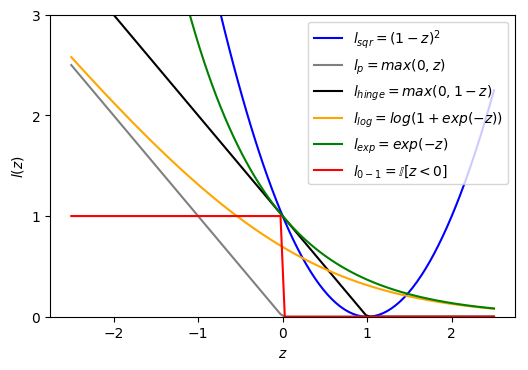

---
categories:
- coding
date: 2018-02-21
lastmod: 2018-02-21
mathjax: true
slug: score-and-loss-function-of-binary-classification
tags:
- Machine Learning
- Classification
title: Scores and Loss Functions for Binary Classification
toc: true
featured: true
---

Binary classification is one of the most basic problems in supervised learning. This post surveys the many machine learning algorithms that solve it, from the angle of score values and loss functions. Detailed treatments of these algorithms can be found in the standard textbooks[^1][^2].

<!--more-->

Given a dataset $D={(\mathbf x_1, y_1), (\mathbf x_2, y_2), ..., (\mathbf x_m, y_m)}$ , where $y_i\in \{-1, 1\} $ and $\mathbf x_i=(x_{i1}, x_{i2}, ...x_{id})$ is a d-dimensional vector. Note that some sources prefer $\{0, 1\}$ for the two classes. Which numbers you use makes no difference in principle, but it does produce small differences in how the math is written.

"Score value" is not a formal term in machine learning algorithms, but it is a useful lens to adopt. We want a scoring function $s(\mathbf x)$ for a sample $\mathbf x$, and its basic property is simple: it must have the same sign as the target value $y$ — positive samples score positive, negative samples score negative — so that the final binary classification function is $sign(s(\mathbf x))$.

So how do we build the scoring function? The intuitive idea is a weighted sum over the sample's $d$ attributes, which expresses how important each attribute is to the score. A score built this way does not necessarily discriminate at the value 0, so we add a bias term, giving the scoring function $s(\mathbf x)=w^T\mathbf x+b$. Many algorithms derive from this basic scoring function.

The basic criterion for a binary classification problem is the classification error rate. Per sample, the loss is 0 when the classification is correct and 1 when it is wrong; this loss is usually called the 0-1 loss, written $l_{0-1}=\mathbb{I}[sign(s(\mathbf x))\neq y]$.

If we consider positive and negative samples uniformly and let $z=s(\mathbf x)*y$ , then $z$ is always positive when the classification is correct. Call it the absolute score: $z$ measures whether the classification is right. Then $l_{0-1}=\mathbb{I}[sign(z)= -1]$, so $l_{0-1}$ is a piecewise function of $z$. From the perspective of optimization theory, this function has no gradient or [subgradient](https://zh.wikipedia.org/wiki/%E6%AC%A1%E5%AF%BC%E6%95%B0), so we need to find an approximation of it to optimize. The basic criteria for that approximation $\widetilde l$ are: it is always non-negative; and when it is small, $l_{0-1}$ is small.

The score is a linear combination of the attributes $X$; from another angle, the score is also a linear combination of the weights $w$. In general we transform $X$ into a new feature space to get $\phi (\mathbf x)$. The score is then $z=(w^T\mathbf \phi (\mathbf x)+b)y$. The analysis above is essentially unchanged, only the model is more complex. Unless stated otherwise, the following analysis stays in the original space.

## 1 Linear regression

We require the score to have the same sign as the target. If we set a narrower goal, we can make the score itself $\{-1, 1\}$; that is the linear regression problem, with the squared error as the loss function. (This admits an intuitive reading, and it can also be derived from maximum likelihood by assuming the sample error is normally distributed; that is not the focus of this post.) Note that $l_{sqr}=(s(\mathbf x)-y)^2=(s(\mathbf x) * y-y^2)^2=(z-1)^2$, so the error function is a quadratic function of the absolute score $z$. As the figure shows, $l_{sqr}$ is always greater than $l_{0-1}$, and when $l_{sqr}$ is relatively small, $l_{0-1}$ is relatively small too, so it can serve as an approximation of $l_{0-1}$.

Linear regression has a closed-form solution $w=(X^TX)^{-1}X^Ty$, so binary classification with linear regression is very simple, but the results are generally not good. Why? The $l_{sqr}$ curve shows that when the absolute score is large, $l_{0-1}$ should be 0; intuitively, a large absolute score is a good thing, indicating high discriminative power, yet $l_{sqr}$ penalizes it more heavily. That is unreasonable. Linear regression can still give a passable $w$, usable as an initial value for other algorithms.

## 2 Perceptron learning

Perceptron learning can be understood through the following intuition: for the absolute score, when it is positive the classification is correct and we consider the error to be 0; when it is negative, the farther it is from 0 the larger the error, i.e. $l_p=max(0, -z)$. The $l_p$ curve is also an approximation of $l_{0-1}$. It is a piecewise function too, but it admits a subgradient: for $z\geqslant 0$ the gradient is taken as 0, and for $z<0$, $\frac{dl_p}{dw}=\frac {dl_p}{dz}\frac{dz}{dw}=-1*y\mathbf x=-y\mathbf x$. Using stochastic gradient descent, $w\leftarrow w+\eta y\mathbf x$ — that is, we optimize only when the score is wrong, which is exactly what the perceptron learning algorithm does.

## 3 Support vector machine

The perceptron's error function can be improved further. We want the absolute score to be sufficiently large, so that we are more confident a sample is positive; since $z$ scales with $w,b$, we may define "sufficiently large" as greater than 1. This gives $l_{hinge}=max(0, 1-z)$, known as the hinge loss. Accounting for structural risk, our optimization objective is

$$
\underset{w,b}{min}=\frac{1}{2}\left \|w  \right \|^2+C\sum_{i=1}^{m}max(0, 1-z)
$$

With the slack variable method this becomes the soft-margin support vector machine, and the model is found by quadratic programming.

In terms of score, a sufficiently large score gives the model good robustness on new samples, and that is exactly where the support vector machine excels. If a feature space is introduced, solving the SVM requires computing many inner products; simplifying the inner products in feature space into a kernel function in the original space brings in the kernel method.

## 4 Logistic regression

On top of the $z$ value, we want it to yield a probability that measures how likely, or how strongly, the classification is correct. That is, map the range of $z$ from $(-\infty , +\infty )$ to $(0,1)$. The sigmoid function is a good choice: it is differentiable and gives exactly probability 0.5 at 0. That is,

$$
sigmoid(z)=\frac {1}{1+exp(-z)}
$$

Then, based on this sigmoid function, we emulate the loss function $l_{0-1}(z)$. We require the loss to decrease with respect to $z$ and to stay positive; taking the log of the probability and then negating it gives

$$
l_{log}(z)=-log(sigmoid(z))=log(1+exp(-z))
$$

The figure shows that this is also an approximation of $l_{0-1}(z)$. Taking the log loss as the optimization objective:

$$
\underset{w,b}{min}=\sum_{i=1}^{m}log(1+exp(-z))+ \lambda\left \|w  \right \|^2
$$

This is regularized logistic regression. Since $l_{log}(z)$ is differentiable everywhere, it can be solved with optimization methods such as gradient descent.

## 5 AdaBoost

The exponential function also satisfies the basic conditions for approximating $l_{0-1}$, i.e. the loss is defined as $l_{exp}(z)=exp(-z)$.

Combining the exponential loss function with an additive model yields the AdaBoost algorithm.

An additive model can be understood like this: suppose the d-dimensional vector $\phi(\mathbf x)$ we obtain in feature space corresponds to d weak classifiers, that is, classifiers a little better than a 50% random guess. The so-called Boosting method effectively combines these weak classifiers to build a strong classifier. An additive model is still essentially a linear model, and still has the scoring function $s(\mathbf x)=w^T\mathbf \phi (\mathbf x)$. (Since a weak classifier can carry its own bias, we take $b=0$.) The only difference is that here $\phi(\mathbf x)$ represents a weak classifier rather than a simple attribute transform (which, in essence, it still is).

AdaBoost is a step-by-step iterative process. Suppose that after $m-1$ rounds of iteration we have the scoring function $s_{m-1}(\mathbf x)=\sum_{i=1}^{m-1}w_i\phi_i(\mathbf x)$, and after the $m$-th round we obtain $w_m, \phi_m(\mathbf x), s_m(\mathbf X)$; then $s_m(\mathbf X)=s_{m-1}(\mathbf X)+w_m\phi_m(\mathbf x)$. AdaBoost's optimization objective is to make the scoring function obtained at each step minimize the exponential loss, that is,

$$
w_m, \phi_m = arg\underset{w,\phi}{min}\sum_{i=1}^Nexp(-z_{mi})  \quad z_{mi}=y_is_m(\mathbf X_i)
$$

Further derivation of this expression is not detailed here.

## Summary

Six loss functions so far. All of them are monotonically non-increasing functions of the score, and the last five are surrogate approximations of the 0-1 loss. Whether solving the surrogate yields the solution of the original problem has been studied in depth, under the name of the "consistency" of surrogate losses[^3].

In addition, if we need to find all positive examples among the samples and rank them, the score must already carry ranking properties while being optimized. The log loss and exponential loss are monotonically decreasing, so the scores computed by models optimized on them can take part in ranking; the other loss functions are not monotonically decreasing, so their scores are not suitable for ranking.

[^1]: Statistical Learning Methods, Li Hang
[^2]: Machine Learning, Zhou Zhihua
[^3]: https://projecteuclid.org/download/pdf_1/euclid.aos/1079120130
