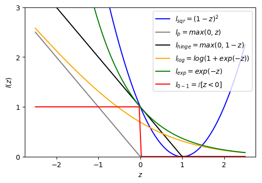

---
categories:
- coding
date: 2018-02-21
lastmod: 2018-02-21
mathjax: true
slug: score-and-loss-function-of-binary-classification
tag: 機械学習
tags:
- 機械学習
- 分類
title: 二値分類問題のスコア値と損失関数
toc: true
featured: true
---

二値分類問題は教師あり学習における最も基本的な問題の一つである。本稿は、スコア値と損失関数の観点から、二値分類問題を解く数多くの機械学習アルゴリズムを整理することを目的とする。各アルゴリズムの詳細については、関連する教科書[^1][^2]を参照されたい。

<!--more-->

データ集合$D={(\mathbf x_1, y_1), (\mathbf x_2, y_2), ..., (\mathbf x_m, y_m)}$ が与えられ、ここで$y_i\in \{-1, 1\} $、$\mathbf x_i=(x_{i1}, x_{i2}, ...x_{id})$はd次元ベクトルである。なお、資料によっては二値分類に$\{0, 1\}$を用いることを好むが、二値分類をどの数値で表すかに原理上の違いはなく、数学的な表現に若干の差異が生じるだけである。

スコア値は機械学習アルゴリズムにおける正式な用語ではないが、次のような見方を導入してよいだろう。サンプル$\mathbf x$についてのスコア関数$s(\mathbf x)$を構成したい。その基本的性質は単純で、目標値$y$と同符号であること、すなわち正サンプルのスコアは正の数、負サンプルのスコアは負の数であることを要求する。そうすれば最終的な二値分類関数は$sign(s(\mathbf x))$となる。

では、スコア関数をどのように構成すればよいか。直感的な考え方は、サンプルの$d$個の属性を重み付きで総和することであり、これによって各属性のスコアにおける重要度を反映できる。こうして構成したスコアが0のところで識別の働きをもつとは限らないため、さらにバイアス項を加える。したがってスコア関数は$s(\mathbf x)=w^T\mathbf x+b$となり、この基本的なスコア関数から多くのアルゴリズムが派生する。

二値分類問題を評価する基本尺度は分類誤り率である。各サンプルについて損失関数を計算するなら、分類が正しければ損失0、誤っていれば損失1となる。この種の損失関数は一般に0-1損失関数と呼ばれ、$l_{0-1}=\mathbb{I}[sign(s(\mathbf x))\neq y]$と書ける。

正負のサンプルを統一的に扱うために$z=s(\mathbf x)*y$ とおくと、分類が正しいとき$z$は必ず正の値となる。これを絶対スコア値と呼ぶことにしよう。$z$は分類が正しいかどうかの尺度である。このとき$l_{0-1}=\mathbb{I}[sign(z)= -1]$であるから、$l_{0-1}$は$z$に関する区分関数となる。最適化理論の観点から見ると、この関数は勾配も[劣勾配](https://zh.wikipedia.org/wiki/%E6%AC%A1%E5%AF%BC%E6%95%B0)も求められないため、その近似を見つけて最適化する必要がある。近似$\widetilde l$の基本要件は、常に非負の値であること、そしてそれが小さいとき$l_{0-1}$も小さいことである。

スコア値は属性$X$の線形結合であり、別の角度から見れば、スコア値は重み$w$についての線形結合でもある。一般には$X$を新しい特徴空間へ変換して$\phi (\mathbf x)$を得る。するとスコア値は$z=(w^T\mathbf \phi (\mathbf x)+b)y$となる。以上の分析はほぼそのまま成り立ち、モデルの複雑さが増すだけである。以下の分析は特に断らない限り元の空間で行う。

## 1 線形回帰

スコア値が目標値と同符号であることを要求するが、目標をもう少し狭く設定して、スコア値を直接$\{-1, 1\}$としてもよい。これが線形回帰問題であり、損失関数には誤差の二乗を用いる（直感的に理解することもできるし、サンプルの誤差が正規分布に従うと考えて最尤の観点から導くこともできるが、本稿の主題ではない）。$l_{sqr}=(s(\mathbf x)-y)^2=(s(\mathbf x) * y-y^2)^2=(z-1)^2$に注意すれば、誤差関数は絶対スコア値$z$に関する二次関数である。図から分かるように、$l_{sqr}$は常に$l_{0-1}$より大きく、しかも$l_{sqr}$が小さいとき$l_{0-1}$も小さいので、$l_{0-1}$の近似として用いることができる。

線形回帰には閉形式解$w=(X^TX)^{-1}X^Ty$があるため、線形回帰で二値分類を行うのは非常に簡単である。しかし効果は一般にあまりよくない。なぜか。$l_{sqr}$の曲線から分かるように、絶対スコア値が大きいとき$l_{0-1}$は0であるべきであり、直感的には絶対スコア値が大きいことは識別度が高いという良いことなのに、$l_{sqr}$はかえってより大きな罰を与える。これは不合理である。線形回帰はそれなりの$w$を与えることができ、他のアルゴリズムの初期値として利用できる。

## 2 パーセプトロン学習

パーセプトロン学習は次のような直感的な考え方で理解できる。絶対スコア値について、それが正の数であれば分類は正しく、誤差は0とみなす。負の数であれば、0から遠いほど誤差が大きいとみなし、すなわち$l_p=max(0, -z)$とする。$l_p$の曲線から見ても、これも$l_{0-1}$の近似である。区分関数ではあるが劣勾配は求められ、$z\geqslant 0$のとき勾配を0とみなし、$z<0$のとき$\frac{dl_p}{dw}=\frac {dl_p}{dz}\frac{dz}{dw}=-1*y\mathbf x=-y\mathbf x$となる。確率的勾配降下法を用いれば$w\leftarrow w+\eta y\mathbf x$、つまりスコアを誤ったときにのみ最適化を行う。これがまさにパーセプトロン学習アルゴリズムの行っていることである。

## 3 サポートベクターマシン

パーセプトロン学習の誤差関数はさらに改良できる。絶対スコア値が十分に大きければ、そのサンプルを正サンプルとみなすことにいっそう安心できる。$z$は$w,b$についてスケール可能であることを考慮し、十分に大きいとは1より大きいことと定義してよい。そこで$l_{hinge}=max(0, 1-z)$が得られ、この損失関数はヒンジ損失関数と呼ばれる。構造リスクを考慮すると、最適化目標は次となる。

$$
\underset{w,b}{min}=\frac{1}{2}\left \|w  \right \|^2+C\sum_{i=1}^{m}max(0, 1-z)
$$

スラック変数を用いることでソフトマージンのサポートベクターマシンになり、二次計画問題として解いてモデルを求めることができる。

スコア値の観点から理解すると、スコア値が十分に大きいことで、モデルは新しいサンプルに対して良好な頑健性をもつ。これがまさにサポートベクターマシンの優れている点である。特徴空間を導入すると、サポートベクターマシンの求解過程では内積を大量に計算する必要があるが、特徴空間の内積を元の空間のカーネル関数に簡約することでカーネル法を導入できる。

## 4 ロジスティック回帰

$z$の値をもとに、分類が正しい確率、すなわちその程度を測る確率を算出したい。つまり$z$の値域を$(-\infty , +\infty )$から$(0,1)$へ写像する。そのためにはsigmoid関数が良い選択であり、勾配が求められ、しかも0のところで確率がちょうど0.5になる。すなわち

$$
sigmoid(z)=\frac {1}{1+exp(-z)}
$$

次に、このsigmoid関数に基づいて損失関数$l_{0-1}(z)$を模擬する。損失関数は$z$について減少し、しかも常に正の数であることを要求する。確率の対数をとってから符号を反転することを考えれば、次のようになる。

$$
l_{log}(z)=-log(sigmoid(z))=log(1+exp(-z))
$$

図から分かるように、これも$l_{0-1}(z)$の一種の近似である。対数損失関数を最適化目標とすると、

$$
\underset{w,b}{min}=\sum_{i=1}^{m}log(1+exp(-z))+ \lambda\left \|w  \right \|^2
$$

これは正則化付きのロジスティック回帰であり、$l_{log}(z)$は至る所で微分可能であるため、勾配降下法などの最適化手法で解くことができる。

## 5 AdaBoost

指数関数も同様に$l_{0-1}$を近似する基本条件を満たす。すなわち損失関数を$l_{exp}(z)=exp(-z)$と定義する。

指数損失関数と加法モデルを組み合わせることで、AdaBoostアルゴリズムを導出できる。

加法モデルとは次のように理解できる。得られた特徴空間におけるd次元ベクトル$\phi(\mathbf x)$がd個の弱分類器に対応すると仮定する。弱分類器とは、ランダムに推測する50%の正解率より少しだけ高い分類器のことである。Boost法とは、これらの弱分類器を有効に組み合わせて強分類器を構築する方法である。加法モデルは本質的に依然として線形モデルであり、スコア関数はやはり$s(\mathbf x)=w^T\mathbf \phi (\mathbf x)$となる。（弱分類器自体がバイアスをもちうることを考慮し、$b=0$とする。）ただしここでの$\phi(\mathbf x)$は単純な属性変換ではなく、1つの弱分類器を表す（本質的に見れば、これも一種の属性変換である）。

AdaBoostは段階的に反復する過程である。$m-1$回の反復を経てすでにスコア関数$s_{m-1}(\mathbf x)=\sum_{i=1}^{m-1}w_i\phi_i(\mathbf x)$が得られていると仮定し、第$m$回の反復後に$w_m, \phi_m(\mathbf x), s_m(\mathbf X)$が得られるとすると、$s_m(\mathbf X)=s_{m-1}(\mathbf X)+w_m\phi_m(\mathbf x)$となる。AdaBoostの最適化目標は、各段階で得られるスコア関数を指数損失関数について最小化することであり、すなわち

$$
w_m, \phi_m = arg\underset{w,\phi}{min}\sum_{i=1}^Nexp(-z_{mi})  \quad z_{mi}=y_is_m(\mathbf X_i)
$$

この式のさらなる導出についてはここでは詳述しない。

## まとめ

以上、6種類の損失関数を紹介した。いずれもスコア値に関する単調非増加関数であり、うち後半の5種類は0-1損失関数の近似的な代替である。代替関数を解くことで元の問題の解が得られるかどうかについては深い研究があり、代替損失の「一致性」問題と呼ばれる[^3]。

さらに、すべてのサンプルの中から正例を見つけて順序付けしたい場合、スコア値は最適化に参加する時点で順序付けの性質を備えている必要がある。対数損失と指数損失は単調減少であり、これらを最適化目標とするモデルが算出するスコア値は順位付けに参加できる。他のいくつかの損失関数は単調減少ではないため、対応するスコア値は順位付けに適さない。

[^1]: 統計的学習方法 李航
[^2]: 機械学習 周志华
[^3]: https://projecteuclid.org/download/pdf_1/euclid.aos/1079120130
